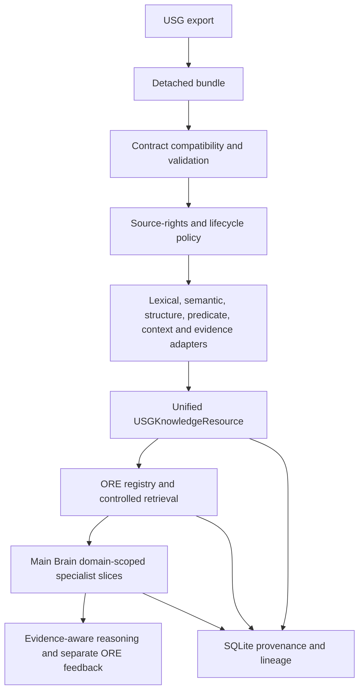

# Phase 6 — Reliability, observability, compatibility and release verification

## 20. Integration test coverage

The integration test suites are grouped by boundary:

| Boundary | Tests |
| --- | --- |
| Bundle loading and structural validation | `test_usg_bundle_io.py` |
| Lexical forms, lemmas and senses | `test_usg_lexical_adapter.py` |
| Sense-to-concept and semantic knowledge | `test_usg_semantic_adapter.py`, `test_usg_semantic_knowledge_adapter.py` |
| Classes, relations and predicate frames | `test_usg_structure_adapter.py`, `test_usg_semantic_knowledge_adapter.py` |
| Context, evidence, morphology and provenance | `test_usg_language_integration.py` |
| Unified resource and controlled access | `test_usg_knowledge_adapter.py`, `test_usg_knowledge_access.py` |
| Main Brain routing and feedback | `test_usg_coordinator_integration.py` |
| Compatibility, explicit migrations, SQLite lineage and diagnostics | `test_usg_phase6_integration.py` |
| Large bundle import, memory and exact lookup benchmarks | `tests/performance/test_usg_performance.py` |

The existing suites independently exercise adapters and relationships. Phase 6 adds cases for unsupported versions, false semantic-preservation declarations, source record lineage, duplicate/conflicting lineage, nested diagnostic scrubbing and cyclic lineage traversal. Existing adapter tests continue to cover malformed references, unresolved frames, conflicting evidence and unsupported records.

## 21. SQLite annotation coverage, execution events and artifact lineage

ORE's AST annotation catalogue remains the single annotation source. Run the synchronizer from the repository root after changes:

```powershell
python -m ore_usg.annotation_sync --repository-root .
```

It scans `ore_usg`, `ore_blackboard`, `ore_contracts`, and `ore_logger` and writes module, class, function, and method annotations to the existing `ore_logs/ore_logger.sqlite3` database. Source hashes and stale annotation handling continue to be managed by `ore_logger.catalog.sync_repository`. The database is generated locally, not committed as a binary artifact.

`USGSQLiteObservability` extends that same SQLite file with three additive tables:

- `module_execution_events`: module/version, operation, status, run ID, duration, input/output artifact IDs, bundle identity and bounded diagnostic metadata.
- `artifact_lineage`: immutable artifact hash, ORE contract/schema version, producer, run ID, parent IDs, source namespace/bundle/digest and original USG record IDs.
- `usg_migration_events`: migration ID, source/target contracts and digests, and semantic-change declaration.

It stores hashes, identifiers and bounded metadata, not raw definitions, evidence text or complete bundle payloads. Repeated identical lineage writes are idempotent; conflicting writes for an existing artifact ID fail. Lineage traversal detects cycles and enforces a maximum depth.

Example:

```python
from ore_contracts import ContractCatalog
from ore_contracts.module_registry import ModuleRegistry
from ore_logger.database import LoggerDatabase
from ore_usg import USGSQLiteObservability, register_usg_knowledge_module

registry = ModuleRegistry(ContractCatalog())
observer = USGSQLiteObservability(LoggerDatabase("ore_logs/ore_logger.sqlite3"))
register_usg_knowledge_module(registry, observability=observer)

# Execute the registered importer/retrieval backend through ORE as usual.
# The observer records module events and artifact lineage automatically.
events = observer.list_module_execution_events(limit=20)
lineage = observer.trace("derived-artifact-hash")
```

For an original source bundle, use `record_source_bundle(..., bundle=source_bundle)`; it indexes IDs from records, relations, mappings, evidence, contexts and sources. Call `record_artifact_lineage` for each derived artifact and include its parent artifact hashes.

## 22. Compatibility and explicit migrations

The supported inbound profile is `USG-KNOWLEDGE/0.1.0`. ORE contracts are versioned independently:

| Contract | Supported schema |
| --- | --- |
| `ORE.USG.KNOWLEDGE_BUNDLE` | `0.1.0` |
| `ORE.USG.LEXICON` | `1.0.0` |
| `ORE.USG.KNOWLEDGE` | `1.0.0` |
| `ORE.USG.KNOWLEDGE_QUERY` | `1.0.0` |
| `ORE.USG.KNOWLEDGE_RETRIEVAL` | `1.0.0` |
| `ORE.BLACKBOARD.USG_MODULE_KNOWLEDGE` | `1.0.0` |

`inspect_usg_compatibility` and `require_usg_compatibility` detect unsupported source profiles. `inspect_ore_contract_catalog` and `require_ore_contract_catalog` check the live ORE catalogue. No implicit upgrade is attempted.

Migrations must be registered as named `USGMigration` objects with exact source/target contract IDs and an explicit transform. The caller must pass the exact ordered migration chain to `USGMigrationRegistry.apply`. A migration marked `PRESERVED` is rejected if it changes the canonical source-backed semantic projection; a `DECLARED_CHANGE` migration requires a substantive explanation and remains explicitly marked. The original mapping is not modified. There is no guessed generic migration for unknown schemas.

## 23. Performance and resource tests

`ore_usg.performance` provides:

- `benchmark_usg_import`: repeated import wall time, median/min/max, peak traced Python allocation, bundle size and imported record counts.
- `benchmark_usg_lookups`: median, p95 and maximum exact lexical, semantic and predicate lookup latency and result counts.
- `measure_usg_resource_footprint`: linked inventory counts and duplicate stable IDs in a unified snapshot.

Tests build large synthetic bundles with more than 1,000 additional lexical forms. They assert measurements and data integrity, not fixed timing thresholds: absolute timings are machine/runtime dependent. The importer creates a linked unified snapshot; Phase 5's coordinator caches digest-keyed snapshots and bounded lookup projections rather than passing the entire resource to every specialist.

## 24. Complete integration flow, licensing and errors



Adapters preserve the source record IDs, bundle ID/digest, endpoint direction, sense distinctions, contexts, evidence statuses and source provenance. Unsupported or ambiguous assertions are excluded or retained as unresolved according to their adapter report; they are not guessed into facts.

The default import policy permits local use only for source-rights states explicitly allowed by policy (normally `KNOWN_PERMITTED` and `INTERNAL`). `RESTRICTED`, `UNKNOWN` and `PROHIBITED` sources are excluded by default. Local-use permission does not grant redistribution rights. ORE's import and logger do not copy raw source evidence text into observability metadata.

Invalid bundle shape, duplicate/missing IDs, unsupported kinds/states, bad references, malformed JSON and unsupported contract versions are errors. Incomplete predicate frames and ambiguous relations remain unresolved/non-executable where the adapter supports that state. Contradictory evidence remains a contradiction assertion, not objective falsity. Heuristic scores are not calibrated probabilities.

Example consumer access:

```python
from ore_usg import USGKnowledgeAccess, USGKnowledgeQuery

access = USGKnowledgeAccess(imported_resource)
lexical_entries = access.lexical_entries("bank", language="en")
all_senses = access.lexical_meanings("bank", language="en")
concepts = access.semantic_concepts("Finance")
result = access.query(USGKnowledgeQuery(mode="EXACT", query="transfer"))
```

## 25. Reproducible verification and release gate

From a clean Windows checkout:

```powershell
python -m pip install -e ".[dev]"
python -m ore_usg.annotation_sync --repository-root .
python -m pytest tests/test_usg_bundle_io.py tests/test_usg_lexical_adapter.py tests/test_usg_semantic_adapter.py tests/test_usg_semantic_knowledge_adapter.py tests/test_usg_structure_adapter.py tests/test_usg_language_integration.py -q
python -m pytest tests/test_usg_knowledge_adapter.py tests/test_usg_knowledge_access.py tests/test_usg_coordinator_integration.py tests/test_usg_phase6_integration.py -q
python -m pytest tests/performance/test_usg_performance.py -q
python -m pytest -q
```

Record the Python/dependency versions, exact commit, bundle digest, annotation report, SQLite schema version and benchmark report. Run tests against the exact PR commit. Failures must be fixed and the affected tests rerun before release. This phase's tests have not been run in the hosted environment; the release verification gate remains open until the user runs the commands locally.
